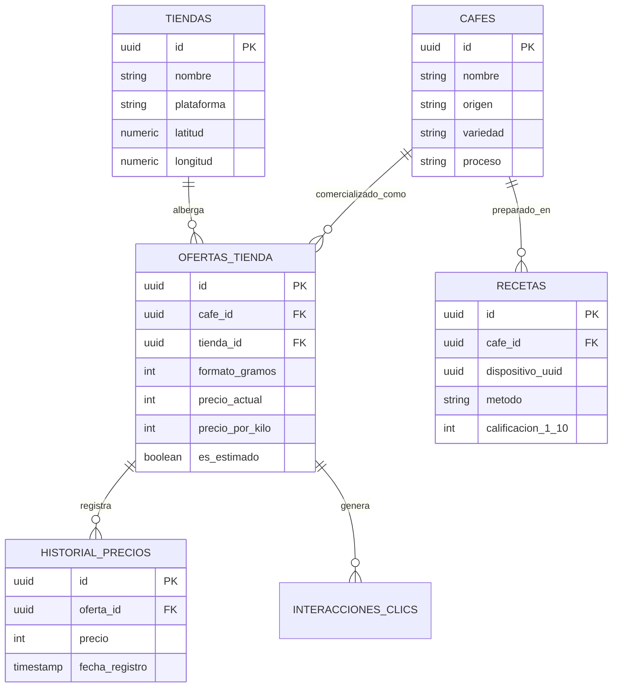

# Documento de Requerimientos de Software (SRS) - Cafesitios MVP

**Versión:** 2.0 (Agent-Friendly)  
**Fecha:** Octubre 2026  
**Estado:** Especificación Técnica Completa  
**Propósito:** Guía de desarrollo e implementación libre de ambigüedades para desarrolladores humanos y agentes de Inteligencia Artificial (Cursor, Antigravity, Copilot).

---

## 1. Visión y Propósito del Producto

**Cafesitios** es un agregador y comparador web especializado en café de grano y especialidad en Chile. Su objetivo es resolver la fragmentación del mercado nacional de café reuniendo en una plataforma unificada la oferta de múltiples tostadurías y e-commerce (Shopify, WooCommerce, PrestaShop, Odoo, Menu Express).

### 1.1 Problema Central
- Dispersión de información entre decenas de sitios web independientes.
- Falta de estandarización en formatos y gramajes (bolsas de 250g, 500g, 1kg, 220g, etc.), lo que dificulta al consumidor evaluar qué oferta es verdaderamente más conveniente.
- Variaciones de precio constantes sin trazabilidad histórica.

### 1.2 Solución MVP
- **Estandarización Métricas**: Cálculo automático del **precio por kilo ($/kg)** para todos los productos.
- **Transparencia**: Distinción clara entre precios por kilo oficiales (provistos por la tienda) y estimados (calculados por algoritmo).
- **Modelo de Negocio Directo**: Plataforma de descubrimiento y redirección mediante clics salientes (*outbound clicks*) hacia la tienda oficial del tostador, sin cobro de comisiones ni pasarela de pago propia.

---

## 2. Requerimientos Funcionales (Casos de Uso)

### CU-01: Búsqueda y Filtrado Global de Catálogo
- **Descripción**: Permite a los usuarios buscar cafés mediante términos clave o aplicar filtros sintéticos.
- **Regla RN-01 (Normalización de Sinónimos)**: La barra de búsqueda debe normalizar variaciones ortográficas y sinónimos comunes en la industria del café:
  - *"geisha"* $\leftrightarrow$ *"gesha"*
  - *"borbón"* $\leftrightarrow$ *"bourbon"*
  - *"anaeróbico"* $\leftrightarrow$ *"anaerobio"*
  - *"lavado"* $\leftrightarrow$ *"washed"*
- **Filtros Soportados**:
  - Tostaduría / Tienda de origen.
  - País de origen del grano (Ej. Colombia, Etiopía, Brasil, Guatemala).
  - Proceso de beneficio (Lavado, Natural, Honey, Anaeróbico).
  - Rango de precio por kilo ($/kg).
  - Disponibilidad en stock (Filtro por defecto: `only_available = true`).

### CU-02: Normalización y Determinación del Precio por Kilo ($/kg)
- **Descripción**: Estandariza la métrica básica de costo para comparar objetivamente empaques de distinto tamaño.
- **Regla RN-02 (Prioridad de Precio por Kilo)**:
  1. **Prioridad 1 (Oficial)**: Si la API de la tienda (ej. Shopify `unit_price`) entrega el valor del precio unitario por kilo de forma explícita, el sistema lo adopta y marca el registro con `es_estimado = false`.
  2. **Prioridad 2 (Estimado)**: Si la tienda no entrega dicha métrica, el sistema extrae los gramos del título o variante (`formato_gramos`) y calcula:
     $$	ext{Precio por Kilo} = \left( rac{	ext{Precio CLP}}{	ext{Gramos}} 
ight) 	imes 1000$$
     Este resultado se almacena con `es_estimado = true`.
- **UI/UX**: Cuando `es_estimado = true`, la tarjeta del producto debe incluir un indicador o badge visual con el texto **"Estimado"** o un tooltip explicativo.

### CU-03: Comparativa Directa Entre Productos (Side-by-Side)
- **Descripción**: Permite seleccionar 2 productos en dispositivos móviles o hasta 4 en pantallas de escritorio para comparar sus atributos lado a lado en un panel modal o vista dedicada.
- **Regla RN-03 (Deduplicación por Gramaje)**: Al agrupar las opciones de empaque de un mismo café, las variantes de molienda (ej. "Grano Entero", "Molienda Espresso", "Molienda V60") deben ignorarse y deduplicarse por gramaje (`distinct(formato_gramos)`). Un café con 3 moliendas para bolsas de 250g se presenta como **1 único formato de 250g** para no duplicar filas en la tabla comparativa.

### CU-04: Comparador de Disponibilidad ("Comprar con...")
- **Descripción**: En la vista detallada de un producto, el sistema busca si el mismo lote de café se comercializa en otras tiendas del catálogo.
- **Regla RN-04 (Identidad Estricta de Grano)**: Para vincular dos ofertas como el mismo producto entre tiendas distintas, debe existir coincidencia estricta en:
  1. País de origen.
  2. Finca o Productor.
  3. Variedad botánica.
  4. Proceso de beneficio.
  5. Lote de tueste (si está disponible).
- **UI/UX**: Si se detecta el mismo café en otro comercio, se muestra el botón contextual **[ Comprar con {Otra Tienda} ]**, destacando la diferencia de precio o costo por kilo.

### CU-05: Ordenamiento y Filtrado por Cercanía Física ($0 USD)
- **Descripción**: Ordena o filtra las tostadurías físicas según la ubicación del usuario sin incurrir en costos de APIs pagas (Google Places API).
- **Regla RN-05 (Geolocalización Pasiva Cero Fricción)**:
  - **Nivel 1 (Automático)**: Inferencia de ubicación leyendo la cabecera `x-vercel-ip-city` inyectada en el Edge de Vercel.
  - **Nivel 2 (Manual)**: Selector desplegable de comunas de Chile en la interfaz.
  - **Geocodificación Backend**: Durante el scraping de tiendas físicas, las direcciones se geocodifican mediante la API gratuita de **Nominatim (OpenStreetMap)**.
  - **Cálculo de Distancia**: Se ejecuta directamente en Supabase utilizando la extensión `PostGIS` o `earthdistance` (`ll_to_earth`).

### CU-06: Histórico y Gráfico de Evolución de Precios
- **Descripción**: Despliega un gráfico temporal interactivo (Chart.js / Plotly) en la ficha del producto mostrando las variaciones de precio en el tiempo.
- **Mecanismo**: La información se alimenta de la tabla `historial_precios`, poblada de forma continua por el job nocturno del scraper.

### CU-07: Recomendador Interactivo por Perfil de Taza (Quiz)
- **Descripción**: Asistente interactivo en 3 pasos que guía al usuario hacia el café ideal.
  - Paso 1: Método de preparación (Espresso, Filtro/Goteo, Prensa Francesa, Italiana/Moka).
  - Paso 2: Perfil de sabor preferido (Frutal/Cítrico, Achocolatado/Nuez, Floral, Balanceado).
  - Paso 3: Nivel de tueste (Claro, Medio, Oscuro).
- **Algoritmo de Puntuación**: Ponderación de atributos del producto. Penaliza con -50 puntos los productos agotados.
- **Persistencia**: Las preferencias elegidas se guardan en `localStorage` bajo la clave `cafesitios_perfil_quiz_v1`.

### CU-08: Bitácora de Recetas Local-First y Backend de Guardado Seguro
- **Modo Local-First**: Los usuarios pueden registrar bitácoras de preparación (dosis g, agua ml, ratio, molino, grosor, tiempo s, nota 1-10, reintentar) guardándose por defecto en `localStorage` (`cafesitios_recetas_v1`).
- **Fake Door Validation**: Se muestra un aviso: *"Tus recetas están guardadas solo en este navegador"*, acompañado del botón CTA *"Quiero sincronizar mis recetas en la nube"*. Los clics se registran como métrica de validación de demanda real.
- **API `POST /api/recetas` (5 Capas de Protección)**:
  1. **CORS Restringido**: Permitido solo para dominios oficiales en Vercel (`ALLOWED_ORIGINS`).
  2. **Secreto Compartido**: Cabecera obligatoria `X-App-Client-Key`.
  3. **Honeypot Anti-Bot**: Campo oculto `website_hp` en el payload. Si viene poblado, se rechaza la petición.
  4. **Rate Limiting**: Control estricto con `slowapi` a un máximo de 5 peticiones por minuto por IP.
  5. **Cuota por Dispositivo**: Máximo 15 recetas almacenadas por `dispositivo_uuid`.

### CU-09: Detección y Destacado de Descuentos y Muestras
- **Descuentos**: Si en la ingesta se detecta `compare_at_price > price`, se calcula el porcentaje de descuento `((original - actual) / original) * 100` y se muestra un badge visual (ej. `-15% OFF`).
- **Muestras / Regalos ($0 CLP)**: Si el precio registrado es $0 CLP, el producto se etiqueta automáticamente como **`🎁 Regalo / Muestra`** en verde pastel esmeralda y el costo se renderiza como **"¡Gratis!"**.

### CU-10: Historial de Navegación Local
- **Descripción**: Mantiene una cola FIFO en `localStorage` con los últimos **10 cafés visitados** (`cafesitios_vistos_recientemente_v1`) y las últimas **5 comparaciones realizadas** (`cafesitios_comparaciones_recientes_v1`).

### CU-11: Módulo Flotante de Escucha ("Pensamos en los amantes del café")
- **Descripción**: Widget discreto en la esquina inferior derecha para captar sugerencias cualitativas.
- **API `POST /api/feedback`**:
  - Parámetros: `categoria` (Funcionalidad, Nueva Tienda, Error, Otro), `mensaje`, `contacto_opcional`.
  - Seguridad: Rate Limiting de 2 envíos por hora por IP, Honeypot y anonimización de la dirección IP mediante Hash SHA-256 (`ip_hash`).

---

## 3. Requerimientos No Funcionales (RNF)

- **RNF-01 (Costo Infraestructura $0 USD)**: Despliegue mantenido dentro de los limites gratuitos permanentes:
  - Frontend: **Vercel** (Hosting estático/Edge).
  - Backend API: **Koyeb / Render** (Servidor FastAPI).
  - Base de Datos: **Supabase** (PostgreSQL cloud 500MB).
  - Automatización / Scraper: **GitHub Actions** (Job programado nocturno `0 3 * * *`).
- **RNF-02 (Rendimiento)**: Tiempo de primera carga (FCP) < 1.5s vía CDN de Vercel. Gestión visual de *cold starts* mediante indicadores de carga (*skeleton loaders*) cuando el backend gratuito entra en reposo.
- **RNF-03 (Seguridad & Ocultamiento de API)**:
  - En producción, Swagger UI y ReDoc se desactivan explícitamente (`docs_url=None`, `redoc_url=None`).
  - Middleware CORS configurado únicamente para dominios autorizados.
- **RNF-04 (Extensibilidad Multimotor)**: Arquitectura basada en los patrones *Strategy* y *Factory* para permitir la incorporación de nuevas plataformas de e-commerce (Shopify, WooCommerce, PrestaShop, Odoo, Menu Express) sin modificar el núcleo de la aplicación.
- **RNF-05 (Privacidad y Captura PII)**: Cero recolección de Información de Identificación Personal (PII). Las IP se anonimizan con SHA-256 antes de guardarse en base de datos.

---

## 4. Arquitectura y Stack Tecnológico

```
[ Frontend: Vercel ] <---> [ API: FastAPI en Koyeb/Render ] <---> [ DB: Supabase PostgreSQL ]
  (Astro / HTML + Tailwind)       (Python + SQLAlchemy)               (PostGIS + PgBouncer)
                                           ^
                                           |
                               [ Scraper: GitHub Actions ]
                               (Python + Shopify JSON / BeautifulSoup)
```

---

## 5. Esquema Relacional de Base de Datos (DDL SQL)

```sql
-- Habilitar extensiones requeridas
CREATE EXTENSION IF NOT EXISTS "uuid-ossp";
CREATE EXTENSION IF NOT EXISTS "cube";
CREATE EXTENSION IF NOT EXISTS "earthdistance";

-- 1. Tabla de Tiendas / Tostadurías
CREATE TABLE tiendas (
    id UUID PRIMARY KEY DEFAULT uuid_generate_v4(),
    nombre VARCHAR(100) NOT NULL UNIQUE,
    url_web VARCHAR(255) NOT NULL,
    plataforma VARCHAR(50) NOT NULL, -- shopify, woocommerce, prestashop, odoo, menu_express
    latitud NUMERIC(10, 8),
    longitud NUMERIC(11, 8),
    comuna VARCHAR(100),
    activa BOOLEAN DEFAULT true,
    creado_en TIMESTAMP WITH TIME ZONE DEFAULT CURRENT_TIMESTAMP
);

-- 2. Tabla de Cafés (Entidad de Grano Única)
CREATE TABLE cafes (
    id UUID PRIMARY KEY DEFAULT uuid_generate_v4(),
    nombre VARCHAR(255) NOT NULL,
    origen VARCHAR(100),
    finca_productor VARCHAR(150),
    variedad VARCHAR(100),
    proceso VARCHAR(100),
    lote VARCHAR(50),
    notas_cata TEXT,
    tueste VARCHAR(50),
    creado_en TIMESTAMP WITH TIME ZONE DEFAULT CURRENT_TIMESTAMP
);

-- 3. Tabla de Ofertas por Tienda (Variantes y Precios)
CREATE TABLE ofertas_tienda (
    id UUID PRIMARY KEY DEFAULT uuid_generate_v4(),
    cafe_id UUID REFERENCES cafes(id) ON DELETE CASCADE,
    tienda_id UUID REFERENCES tiendas(id) ON DELETE CASCADE,
    id_variante_tienda VARCHAR(100),
    formato_gramos INT NOT NULL,
    precio_actual INT NOT NULL,
    precio_original INT,
    en_oferta BOOLEAN DEFAULT false,
    descuento_porcentaje INT DEFAULT 0,
    precio_por_kilo INT NOT NULL,
    es_estimado BOOLEAN DEFAULT true,
    link_detalle TEXT NOT NULL,
    imagen_url TEXT,
    disponible BOOLEAN DEFAULT true,
    actualizado_en TIMESTAMP WITH TIME ZONE DEFAULT CURRENT_TIMESTAMP
);

-- 4. Historial de Precios
CREATE TABLE historial_precios (
    id UUID PRIMARY KEY DEFAULT uuid_generate_v4(),
    oferta_id UUID REFERENCES ofertas_tienda(id) ON DELETE CASCADE,
    precio INT NOT NULL,
    fecha_registro TIMESTAMP WITH TIME ZONE DEFAULT CURRENT_TIMESTAMP
);

-- 5. Bitácora de Recetas Almacenadas
CREATE TABLE recetas (
    id UUID PRIMARY KEY DEFAULT uuid_generate_v4(),
    cafe_id UUID REFERENCES cafes(id) ON DELETE SET NULL,
    dispositivo_uuid UUID NOT NULL,
    nombre_receta VARCHAR(150) NOT NULL,
    metodo VARCHAR(100) NOT NULL,
    dosis_cafe_g NUMERIC(5,2) NOT NULL,
    agua_ml NUMERIC(6,2) NOT NULL,
    ratio VARCHAR(20),
    molino_usado VARCHAR(100),
    grosor_molienda VARCHAR(50),
    temperatura_c INT,
    tiempo_total_s INT,
    calificacion_1_10 INT CHECK (calificacion_1_10 BETWEEN 1 AND 10),
    reintentar BOOLEAN DEFAULT true,
    notas_catado TEXT,
    creado_en TIMESTAMP WITH TIME ZONE DEFAULT CURRENT_TIMESTAMP
);

-- 6. Sugerencias y Feedback Cualitativo
CREATE TABLE sugerencias_feedback (
    id UUID PRIMARY KEY DEFAULT uuid_generate_v4(),
    categoria VARCHAR(50) NOT NULL,
    mensaje TEXT NOT NULL,
    contacto_opcional VARCHAR(150),
    ip_hash VARCHAR(64) NOT NULL,
    creado_en TIMESTAMP WITH TIME ZONE DEFAULT CURRENT_TIMESTAMP
);

-- 7. Registro de Clics e Interacciones
CREATE TABLE interacciones_clics (
    id UUID PRIMARY KEY DEFAULT uuid_generate_v4(),
    cafe_id UUID REFERENCES cafes(id) ON DELETE SET NULL,
    variante_id UUID REFERENCES ofertas_tienda(id) ON DELETE SET NULL,
    tipo_evento VARCHAR(50) NOT NULL, -- outbound_click, compare_view, share
    ip_hash VARCHAR(64) NOT NULL,
    creado_en TIMESTAMP WITH TIME ZONE DEFAULT CURRENT_TIMESTAMP
);

-- 8. Historial de Búsquedas Anonimizadas
CREATE TABLE historial_busquedas (
    id UUID PRIMARY KEY DEFAULT uuid_generate_v4(),
    termino_busqueda VARCHAR(255) NOT NULL,
    resultados_encontrados INT DEFAULT 0,
    creado_en TIMESTAMP WITH TIME ZONE DEFAULT CURRENT_TIMESTAMP
);
```

---

## 6. Diagrama de Entidad-Relación (Mermaid ERD)



---

## 7. Diccionario de Telemetría (Data Layer GTM & GA4)

Todos los eventos se emiten mediante `window.dataLayer.push()` en minúsculas y formato `snake_case`.

| Evento `dataLayer` | Disparador (Trigger) | Parámetros del Payload |
| :--- | :--- | :--- |
| `search` | Ejecución de búsqueda global | `search_term`, `resultados_totales` |
| `aplicar_filtro` | Selección de filtro lateral | `tipo_filtro`, `valor_filtro` |
| `ordenar_catalogo` | Cambio en selector de orden | `criterio_orden` (`kilo` \| `unit`) |
| `select_item` | Clic en tarjeta de producto | `tienda_nombre`, `nombre_cafe`, `precio_por_kilo`, `es_precio_estimado` |
| `comparar_productos` | Activación de modal comparativo | `cafe_a_id`, `cafe_b_id` |
| `comparar_con_tienda` | Clic en "Comprar con..." | `cafe_id`, `tienda_actual`, `tienda_comparada`, `diferencia_precio_clp` |
| `clic_tienda_externa` | Clic saliente a tostaduría | `tienda_destino`, `nombre_cafe`, `formato_gramos`, `precio_clp`, `precio_por_kilo` |
| `completar_quiz_recomendador` | Finalización de Quiz de sabor | `metodo_extraccion`, `perfil_sabor`, `nivel_tueste` |
| `guardar_receta` | Guardado de receta | `metodo_preparacion`, `molino_usado`, `calificacion` |
| `interes_sincronizacion_recetas` | Clic en Fake Door de sincronización | `origen_interaccion`, `total_recetas_locales` |
| `enviar_feedback` | Envío de formulario de feedback | `categoria_feedback` |

---

## 8. Directivas Técnicas para Agentes de IA

1. **Sin Alucinación de Precios**: Los cálculos numéricos deben realizarse con precisión de enteros para CLP. No utilizar redondeos de punto flotante en operaciones financieras.
2. **Respeto a la Inmutabilidad DDD**: Las capas de Dominio (`domain/`), Aplicación (`application/`) e Infraestructura (`infrastructure/`) deben permanecer desacopladas. Las consultas SQL no se ejecutan directamente en los routers de la API.
3. **Manejo de CORS e IP**: Para geolocalización o rate limiting, siempre extraer la IP de la primera entrada del encabezado `X-Forwarded-For` o de `x-vercel-ip-city`.
4. **Exportación e Ingesta**: Todo driver de scraping debe heredar de `BaseDriver` e implementar la extracción resiliente retornando estructuras `CoffeeProductDomain`.
